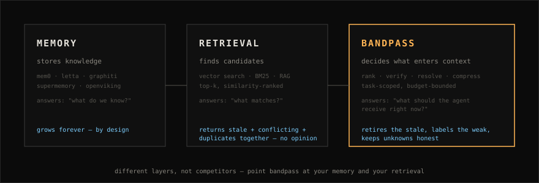
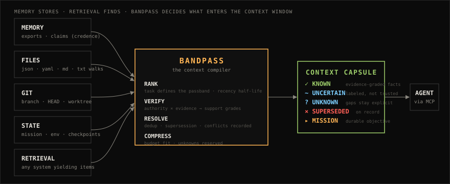

<p align="center">
  
</p>

<h1 align="center">bandpass</h1>

<p align="center"><strong>THE CONTEXT COMPILER FOR AI AGENTS</strong></p>

<p align="center">
  Give the model less context.<br>Give it better grounds.
</p>

<p align="center">
  <a href="https://github.com/MajidAsghariTabrizi/bandpass/actions/workflows/ci.yml"></a>
  <a href="#benchmark"></a>
  <a href="LICENSE"></a>
  = 20">
  <a href="#mcp-quickstart"></a>
</p>

---

> ## COMPILE CONTEXT. DON'T CONCATENATE IT.
>
> Your agent doesn't need every memory.<br>It needs the right state **for this task**.
>
> bandpass turns memory, state, files, git and evidence stores into the
> **smallest context that still makes the task solvable** — as an inspectable,
> provenance-aware **Context Capsule** delivered over MCP.
>
> * Memory stores information. **bandpass decides what the agent should know now.**

---

## 30 seconds

No API key. No model. No install. Deterministic, local, offline:

```bash
npx github:MajidAsghariTabrizi/bandpass demo
```

You will watch **33 raw items** — current facts, a stale Jenkins note, a duplicate,
hearsay, unknowns and a pile of irrelevance — compile into **one 864-token capsule**
with every rejection on the record:

```text
PIPELINE
COLLECT   33 raw items
RANK      33 → 21 in band        12 rejected: relevance below threshold
VERIFY    21 → 21 admissible      1 hearsay surfaced as UNCERTAIN
RESOLVE   16 assertable → 15 current   1 duplicate, 1 superseded
COMPRESS  19 selected (864 / 1200 tokens, estimated)
```

That run, as a picture — stale, duplicate, hearsay, irrelevant all handled on the record:

<p align="center">
  
</p>

Then open the **[Lab](https://majidasgharitabrizi.github.io/bandpass/)** and click COMPILE yourself.

**[ENTER THE LAB →](https://majidasgharitabrizi.github.io/bandpass/)**

## Use bandpass if…

- your agent's context window is 80% history it doesn't need *for this task*
- retrieval returns **stale and current facts together**, with no opinion on which is true
- multiple sources (config, notes, chat, memory) **disagree** and the agent silently picks one
- your memory keeps growing but the agent's answers don't improve
- **unknowns vanish** — nobody told the model what it doesn't know, so it improvises
- conflicting duplicates waste tokens; budgets blow through with no record of what was cut

bandpass is the **decision layer between your storage/retrieval and the model**:

<p align="center">
  
</p>

---

## The Context Capsule

The primary primitive. A compact, inspectable, provenance-aware packet containing
**only the information an agent should receive for the current task** — plus what was
rejected, and why. This is a real capsule (from `npx ... demo`, trimmed):

```text
CONTEXT CAPSULE  bandpass/v1
TASK        deploy billing service to production
BUDGET      1200 tokens (estimated)   USED 864

KNOWN (14)
  ✓ deploy runbook owner = billing team (service.yaml owners field)
    source: config://deploy-billing/service.yaml#owners  support: CORROBORATED
    relevance: 0.56   evidence: 1
  ✓ deployment method = GitHub Actions
    source: config://deploy-billing/ci.yml#deploy-job   support: VERIFIED
    relevance: 0.24   evidence: 2
    supersedes: deployment method = Jenkins
  …

UNCERTAIN (3)
  ~ rollback owner may be platform team (mentioned in chat, unconfirmed)
    support: HEARSAY   relevance: 0.25   evidence: 0
    note: weak evidence (hearsay) — flagged, not trusted

UNKNOWN (2)
  ? current database migration owner for billing = not established
  ? who is on-call during the deploy window = not established

SUPERSEDED (1) — out of context, recorded for inspection
  × deployment method = Jenkins
    explicit-supersession: deployment method = GitHub Actions

MISSION
  ▸ step 4 / 7 — objective: ship billing v2.2 deploy runbook
```

And the part most tools never show you — the rejection ledger:

```text
REJECTED (14)
  × [RANK] legacy.deploy-notes: 2019 deploy notes: billing was deployed with Capistrano…
    reason: stale observation — last observed 2528 days before now; lexical relevance 0.50 decayed to 0.03 (180-day half-life)
  × [RESOLVE] deploy.method.jenkins: deployment method = Jenkins
    reason: superseded — explicitly superseded by deploy.method.gha
  × [RESOLVE] deploy.region.notes: deployment region = eu-west-1
    reason: duplicate — stronger source exists: deploy.region.config
  × [RANK] marketing.site-color: new hero color #334455 approved
    reason: relevance below threshold — relevance 0.00 < 0.15
  …
```

> **Missing context should stay missing. It shouldn't become a confident guess.**
> Unknowns stay explicit. Hearsay stays visible — labeled weak, never asserted.
> Retrieval found Jenkins *and* GitHub Actions; the compiler kept the one that's still true.

---

## How selection works

```text
RAW SOURCES   memory · files · git · mission state · evidence stores
     │
     ▼
RANK           the task defines the passband — lexical relevance with a
               180-day recency half-life; a single token collision is noise
     ▼
VERIFY         authority × evidence → VERIFIED / CORROBORATED / OBSERVED /
               INFERRED / HEARSAY; on-topic hearsay is surfaced, not asserted
     ▼
RESOLVE        duplicates collapse to their strongest source; supersession
               chains win; conflicts resolve by recency then authority,
               with the loser recorded — one current truth per subject
     ▼
COMPRESS       mission + unknowns reserved, facts in relevance order,
               every overflow rejected with its rank
     ▼
CONTEXT CAPSULE  known ✓ · uncertain ~ · unknown ? · superseded × · rejected ×
```

Compilation is a **pure, deterministic function** of `(task, items, budget)` —
same inputs, same capsule, every time. Tokens are estimates (4 chars ≈ 1 token);
bandpass never calls a model and makes no LLM quality claims.

Ask it *why*, and it answers with measurements, not vibes:

```text
WHY — deploy.method.gha
  decision:  SELECTED → KNOWN
  selected because:
    task token overlap: subject [deploy] → relevance 0.24 (threshold 0.15)
    authority: 0.9   evidence: 2   support: VERIFIED
    resolution: won its subject (superseded a conflicting item)
    budget: rank 14, fit=true
  excluded alternatives on the same subject:
    deploy.method.jenkins: SUPERSEDED — superseded by deploy.method.gha (explicit-supersession)
```

And when the task changes, `context_diff` shows exactly what moved:

```text
CAPSULE DIFF  "deploy billing service to production" → "investigate billing database latency"
- deploy.method        deployment method = GitHub Actions  (present only in A)
- deploy.region        deployment region = eu-west-1  (present only in A)
+0  -10  →0  ?0  !0
```

---

## MCP quickstart

bandpass ships a **real MCP server** with six read-only tools
(`context_compile`, `context_explain`, `context_diff`, `context_sources`,
`context_budget`, `context_status`) — protocol-tested in CI against the
JSON-RPC handshake, tool listing and every tool call.

Any MCP client that can launch a stdio server can use it:

```json
{
  "mcpServers": {
    "bandpass": {
      "command": "npx",
      "args": ["-y", "github:MajidAsghariTabrizi/bandpass", "mcp"]
    }
  }
}
```

Then ask your agent: *“compile context for deploying the billing service,
budget 1200”* — it will call `context_compile` and receive a capsule.

<details>
<summary><strong>CLI — compile / explain / diff from your own sources</strong></summary>

```bash
npx github:MajidAsghariTabrizi/bandpass compile --task "ship the pricing hotfix" \
  --source fs:./docs --source git --source credence:claims.jsonl --budget 800

npx github:MajidAsghariTabrizi/bandpass explain --task "ship the pricing hotfix" \
  --item deploy.method.gha

npx github:MajidAsghariTabrizi/bandpass diff \
  --task-a "deploy billing service" --task-b "investigate billing database latency"
```

Library:

```js
import { compile } from 'bandpass';

const capsule = compile(items, { task: 'deploy billing service', budget: 1200 });
console.log(capsule.used_tokens, capsule.known.length, capsule.excluded.length);
```

See [`examples/`](examples/) and [`docs/PROVIDERS.md`](docs/PROVIDERS.md).
</details>

### Client matrix

| Client | Status | Notes |
|---|---|---|
| Generic MCP client (stdio, spec `2025-06-18`) | **VERIFIED** | automated protocol smoke test in CI ([`test/mcp-smoke.mjs`](test/mcp-smoke.mjs)) |
| Claude Code | EXPERIMENTAL | standard `mcpServers` config above; not yet tested end-to-end — PRs welcome |
| Cursor | EXPERIMENTAL | standard MCP config; not yet tested — [#2](https://github.com/MajidAsghariTabrizi/bandpass/issues/2) |
| Codex / Cline / Gemini CLI / OpenCode | UNTESTED | should work over stdio MCP; help verify → [good first issues](https://github.com/MajidAsghariTabrizi/bandpass/labels/good%20first%20issue) |

*Statuses are honest: VERIFIED means an automated test exercised the actual wire protocol.*

---

## Providers

bandpass consumes raw sources through a tiny provider contract —
*report availability, yield items*:

| Provider | Id | What it yields |
|---|---|---|
| [`static`](docs/PROVIDERS.md#static) | `static:*` | JSON item files (`{items:[...]}`) |
| [`filesystem`](docs/PROVIDERS.md#filesystem) | `fs` | deterministic directory walk; json/yaml/md/txt with authority by file type, mtime as observation time |
| [`git`](docs/PROVIDERS.md#git) | `git` | branch, HEAD, worktree state — the "current state" agents usually guess |
| [`env`](docs/PROVIDERS.md#env) | `env` | `BANDPASS_ITEM_<SUBJECT>` variables |
| [`mission`](docs/PROVIDERS.md#mission) | `mission` | mission checkpoint: step N/M, objective, next action |
| [`credence`](docs/PROVIDERS.md#credence) | `credence` | evidence-first claim export (support, state, evidence counts) |

Writing a new provider is ~30 lines: see [`docs/PROVIDERS.md`](docs/PROVIDERS.md).

### Credence, and where bandpass sits

[`credence`](https://github.com/MajidAsghariTabrizi/credence) is an evidence-first
agent memory — every claim carries graded support, evidence links, supersession
history and an explicit UNKNOWN. bandpass does **not** reimplement any of that.
It consumes a claim export over a [documented JSONL interface](docs/PROVIDERS.md#credence):

```text
credence tells you:    what is known, and why.
bandpass decides:      what the agent should receive, right now, for this task.
```

```text
                ┌─────────────────────────────────────┐
   AGENTS       │              bandpass               │
 Claude Code ──▶│  RANK → VERIFY → RESOLVE → COMPRESS │──▶ CONTEXT CAPSULE
 Cursor ───────▶│                                     │
 any MCP ──────▶└──────────────┬──────────────────────┘
  (MCP / CLI / SDK)            │ providers
                 ┌─────────────┼─────────────┬───────────────┐
                 ▼             ▼             ▼               ▼
              files         git state    mission state   credence
             (memory, evidence, state — bandpass consumes, never replaces)
```

Memory is one input. Context **assembly, selection, exclusion and inspection**
are bandpass's job — a layer every memory store, agent framework and harness
can sit behind.

---

## Benchmark

Deterministic, seeded, synthetic corpora where every item's role is known by
construction (12 tasks × ~90 items: 6 required current facts, 4 stale deploy
methods, 8 duplicates, 3 hearsay, 64 irrelevant, 2 unknowns, 1 mission).
Full method: [`bench/BENCHMARK.md`](bench/BENCHMARK.md) — run it yourself: `npm run bench`.

| strategy | input tokens* | irrelevant | stale | duplicates | hearsay asserted / labeled weak | required kept | unknowns kept |
|---|---|---|---|---|---|---|---|
| RAW (stuff everything) | **1435** | 64 | 4 | 8 | 3 / 0 | 6/6 | 2/2 |
| RETRIEVAL (naive top-12) | 201 | 0 | 4 | 1 | 0 / 0 | 6/6 | **0/2** |
| **COMPILE (bandpass, 800 budget)** | **517** | **0** | **0** | **0** | **0 / 3** | **6/6** | **2/2** |

\* *estimates, 4 chars ≈ 1 token. No LLM quality claims — none were measured.
Mean compile latency: **0.6 ms per task** (measured locally, Node 24; hardware varies).*

Read it honestly: raw wastes 64% of its tokens on irrelevance; retrieval is
cheap but silently **loses every unknown and passes 4 superseded deploy methods
as current**; compilation keeps every required fact, retires every stale one,
and keeps the unknowns *unknown*.

---

## Positioning (fair, no fake checkboxes)

These are **different layers**, described in each project's own words — check them directly:

| Project | Describes itself as | Layer |
|---|---|---|
| [Mem0](https://github.com/mem0ai/mem0) | memory layer for AI apps & agents | memory store |
| [Letta](https://github.com/letta-ai/letta) | agents with memory / agent framework | agent framework |
| [Graphiti](https://github.com/getzep/graphiti) | temporal knowledge graphs for agent memory | memory store |
| [Supermemory](https://supermemory.ai/) | memory and continual learning for agents | memory API |
| [OpenViking](https://github.com/volcengine/OpenViking) | self-evolving context database (memory, RAG, skills) | context database |
| [Hindsight](https://github.com/vectorize-io/hindsight) | agent memory that learns (MCP memory server) | memory provider |
| [credence](https://github.com/MajidAsghariTabrizi/credence) | evidence-first agent memory, durable mission runtime | evidence memory |
| **bandpass** | **the context compiler for AI agents** | **compilation layer in front of all of them** |

Stores get bigger and retrieval gets smarter — but *somebody still has to decide
what enters the context window, resolve the contradictions, and keep the
unknowns honest.* That's bandpass. It is deliberately not a store: point it at
yours.

---

## Architecture

<p align="center">
  
</p>

```text
src/
  rank.ts        relevance: task tokens × subject/content, recency half-life
  verify.ts      authority + evidence → support grades
  resolve.ts     dedup · explicit supersession · conflict resolution (recorded)
  compress.ts    budget fitting with reserved mission/unknowns
  capsule.ts     capsule assembly + agent-context rendering
  compile.ts     the pure orchestrator (COLLECT→RANK→VERIFY→RESOLVE→COMPRESS)
  explain.ts     per-item audit trail
  diff.ts        capsule diffing
  providers/     static · fs · git · env · mission · credence
  mcp/server.ts  six read-only MCP tools over stdio
  cli.ts         demo · compile · explain · diff · mcp
```

Details: [`docs/ARCHITECTURE.md`](docs/ARCHITECTURE.md) · Capsule format: [`docs/CAPSULE.md`](docs/CAPSULE.md) · The wider stack: [`docs/ECOSYSTEM.md`](docs/ECOSYSTEM.md)

---

## Honest limitations

- **Relevance is lexical, not semantic.** No embeddings in v0.1 — subject-match
  weighting, a noise gate and recency carry it far, but "the DB moved" won't
  match "database migrated". Pluggable rankers are on the roadmap.
- **Tokens are estimates** (4 chars ≈ 1 token). No tokenizer dependency, no model calls.
- **Conflicts resolve deterministically** (explicit supersession → recency →
  authority), which is auditable but not wise — a human should look at `SUPERSEDED` rows.
- **Providers are pull-based.** No watcher, no daemon, no background sync in v0.1.
- **No LLM quality numbers.** We benchmark context *composition* only.

## Roadmap

- [ ] pluggable rankers (embeddings, BM25, hybrid) behind the same contract
- [ ] `context_compile` streaming over larger corpora (chunked providers)
- [ ] capsule format `v2`: per-item TTL, confidence intervals
- [ ] verified client matrix (Cursor, Claude Code, Codex, Cline — [#2](https://github.com/MajidAsghariTabrizi/bandpass/issues/2) [#3](https://github.com/MajidAsghariTabrizi/bandpass/issues/3))
- [ ] publish to npm (currently GitHub installs only)
- [ ] benchmark corpus packs per domain (devops, support, research)

## Contributing

PRs welcome — [`CONTRIBUTING.md`](CONTRIBUTING.md) has the dev loop
(`npm install && npm run verify` runs typecheck, 35 tests, demo/bench/MCP/lab
smoke in seconds). Start with
[`good first issues`](https://github.com/MajidAsghariTabrizi/bandpass/labels/good%20first%20issue).

MIT © 2026 Majid Asghari Tabrizi · [Security](SECURITY.md) · [Code of Conduct](CODE_OF_CONDUCT.md)

> **COMPILE CONTEXT. DON'T CONCATENATE IT.**
